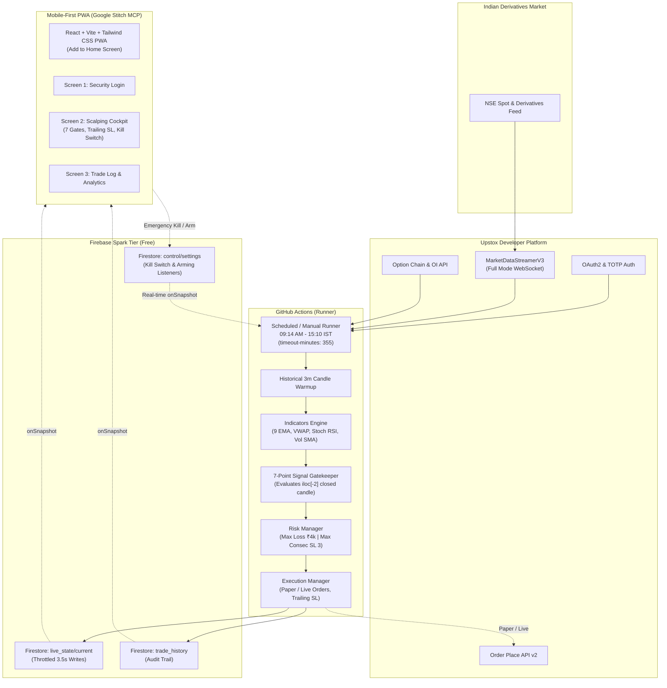

# Nifty // AlphaScalp — Algorithmic Options Scalping System

[](LICENSE)
[](https://www.python.org/)
[](https://stitch.withgoogle.com)
[-brightgreen.svg)]()
[]()

A complete, zero-cost, cloud-hosted **Algorithmic Options Scalping System** for **Nifty 50 & BankNifty** derivatives trading. Engineered with an asynchronous Python 3.11 execution engine, **Upstox API (v2/v3)** live WebSocket tick streaming, **Firebase Firestore (Free Spark Tier)** for sub-second private state synchronization, and a mobile-first **React + Vite PWA** designed using **Google Stitch MCP** (`Obsidian Terminal` Design System).

---

## Architecture Overview



---

## 7-Point Quantitative Signal Gatekeeper

The bot operates strictly on the **last closed 3-minute candle (`iloc[-2]`)** to eliminate intra-candle fakeouts, repainting, and wick traps. Every scalp trade requires **100% agreement (7/7 PASS)** across quantitative parameters:

| # | Gatekeeper Condition | CE Scalp Rule (Call) | PE Scalp Rule (Put) | Telemetry Field |
|---|----------------------|----------------------|---------------------|-----------------|
| **1** | **Active Time Window** | `09:30–12:00` or `13:30–15:10` IST (Skips open chop & lunch lulls) | `09:30–12:00` or `13:30–15:10` IST | `time_window` |
| **2** | **Spot vs VWAP & EMA** | `Spot > VWAP` & `Spot > 9 EMA` & `9 EMA > VWAP` | `Spot < VWAP` & `Spot < 9 EMA` & `9 EMA < VWAP` | `trend_alignment` |
| **3** | **9 EMA Pullback Touch** | Prior candle (`iloc[-3]`) low touched 9 EMA (`low <= EMA_9`) | Prior candle (`iloc[-3]`) high touched 9 EMA (`high >= EMA_9`) | `pullback_verified` |
| **4** | **Trigger Candle Close** | Closed **green** (`close > open`) strictly above 9 EMA | Closed **red** (`close < open`) strictly below 9 EMA | `candle_structure` |
| **5** | **Stochastic RSI Cross** | `%K` crossed above `%D` from oversold (`prev_K < 30`, `curr_K > curr_D`) | `%K` crossed below `%D` from overbought (`prev_K > 70`, `curr_K < curr_D`) | `stoch_rsi_cross` |
| **6** | **1.5x Volume Spike** | Candle volume `> 1.5 * Volume_SMA(15)` | Candle volume `> 1.5 * Volume_SMA(15)` | `volume_surge` |
| **7** | **Option VWAP & OI Filter** | ATM Call `LTP > Call VWAP` AND (Call OI unwinding `< 0` OR Put OI writing `> 0`) | ATM Put `LTP > Put VWAP` AND (Put OI unwinding `< 0` OR Call OI writing `> 0`) | `option_oi_vwap` |

---

## Risk Management & Capital Safeguards

- **Paper Trading First (`DRY_RUN = True`)**: Pre-configured default mode prevents live order execution during testing.
- **Position Sizing Formula**:
  $$\text{Lots} = \max\left(1, \left\lfloor \frac{\text{MAX\_RISK\_PER\_TRADE}}{\text{SL\_POINTS} \times \text{LOT\_SIZE}} \right\rfloor\right)$$
  *(E.g., ₹1,500 max risk, 15 pts SL on Nifty 75 qty = 1 lot).*
- **Hard Initial Stop-Loss**: `10%` below entry option price.
- **Target 1 (+10 pts / 1:1 R:R)**: Instantly moves stop-loss to entry price (**Breakeven locked**).
- **Target 2 (+15 pts / 1:1.5 R:R)**: Books 50% partial profit; trails remaining quantity via **SuperTrend (7, 2)** and **9 EMA**.
- **Time Stop-Loss**: Exits at market if trade fails to generate profit within **3 closed candles (9 minutes)**.
- **Intraday Circuit Breaker**: Auto-halts trading if daily loss reaches `₹4,000` or if `3 consecutive stop-losses` occur.
- **6-Hour GitHub Actions Safety**: Mandatory market shutdown at **15:10 IST** ensures all positions square off safely before GitHub's 360-minute job cap.

---

## Repository Structure

```
options_app_nifty/
├── .github/
│   └── workflows/
│       └── scalp_bot.yml           # Automated runner with timeout and secrets
├── bot/
│   ├── auth.py                     # Upstox OAuth2 + TOTP auto-login generator
│   ├── config.py                   # Centralized dataclass & env parser
│   ├── execution_manager.py        # Order placement, trailing SL, emergency square-off
│   ├── firebase_sync.py            # Throttled Firestore publisher (<7k writes/day)
│   ├── indicators.py               # VWAP, 9 EMA, Stoch RSI, SuperTrend (7,2)
│   ├── main.py                     # Asynchronous main scalper loop
│   ├── market_data.py              # Upstox v3 WebSocket feeder & Option Chain OI
│   ├── requirements.txt            # Python dependencies
│   ├── risk_manager.py             # Position sizing & circuit breaker monitor
│   ├── signal_engine.py            # 7-Point Signal Gatekeeper
│   └── .env.example                # Secret template for local testing
├── dashboard/
│   ├── DESIGN.md                   # Stitch MCP Obsidian Terminal Design System
│   ├── index.html                  # PWA entry point
│   ├── package.json                # React + Vite dependencies
│   ├── tailwind.config.js          # Stitch color palette tokens
│   ├── vite.config.js              # Vite + PWA manifest plugin
│   ├── public/
│   │   ├── manifest.json           # Mobile PWA manifest
│   │   ├── sw.js                   # Service worker for offline shell
│   │   ├── pwa-192x192.svg         # App launcher icon
│   │   └── pwa-512x512.svg
│   └── src/
│       ├── components/
│       │   ├── CockpitScreen.jsx   # Stitch Screen 2 (Execution Cockpit)
│       │   ├── LoginScreen.jsx     # Stitch Screen 1 (Security Gate)
│       │   ├── RiskRulesModal.jsx  # Circuit breaker & rules dialog
│       │   └── TradeLogScreen.jsx  # Stitch Screen 3 (Trade Logs & KPIs)
│       ├── App.jsx                 # Screen router & Firestore real-time bridge
│       ├── firebase.js             # Firebase Web SDK client with demo simulation
│       ├── index.css               # Terminal typography & glow styles
│       └── main.jsx
├── firestore.rules                 # Single-operator authorized Google email rules
└── README.md
```

---

## Step-by-Step Setup Guide

### 1. Upstox Daily Access Token (Option B — Recommended Manual Mode)

Under Option B, you **do not** need to store your Mobile Number, PIN, or TOTP Secret anywhere. You only need an `access_token` generated once each trading day:

1. **Get your token in 10 seconds**:
   Run the interactive generator:
   ```bash
   python tools/generate_token.py
   ```
   Or visit the Upstox OAuth login URL in your browser:
   ```
   https://api.upstox.com/v2/login/authorization/dialog?response_type=code&client_id=YOUR_API_KEY&redirect_uri=https://127.0.0.1:5000/
   ```
2. Log in with your standard Upstox OTP/PIN on their official page.
3. Copy the authorization `code` from the redirect URL and exchange it for your token using `tools/generate_token.py`.
4. When launching the bot in GitHub Actions, simply paste this token into the `upstox_access_token` field!

### 2. Firebase Free Spark Tier Setup (No Credit Card Required)
1. Go to the [Firebase Console](https://console.firebase.google.com/) and create a project (e.g. `nifty-alphascalp`).
2. **Enable Firestore Database**:
   - Create Database in production mode (location: `asia-south1` Mumbai).
   - In **Firestore Rules**, copy and paste the contents of [`firestore.rules`](./firestore.rules) and replace `operator@alphascalp.quant` with your Google email.
3. **Enable Google Authentication**:
   - Build -> Authentication -> Sign-in method -> Enable **Google**.
4. **Generate Service Account for the Python Bot**:
   - Project Settings -> **Service accounts** tab.
   - Click **Generate new private key** -> Save the JSON file.
5. **Get Web App Config for the Dashboard**:
   - Project Settings -> General -> **Your apps** -> Click `</>` (Web App).
   - Copy the `firebaseConfig` keys into `dashboard/.env`.

### 3. GitHub Encrypted Secrets Setup (Option B)
In your GitHub repository, navigate to **Settings -> Secrets and variables -> Actions -> New repository secret**:

| Secret Name | Value | Required for Option B? |
| :--- | :--- | :--- |
| `FIREBASE_SERVICE_ACCOUNT_JSON` | Entire contents of Firebase service key JSON | **Yes** (Free state sync) |
| `AUTHORIZED_USER_EMAIL` | `your_email@gmail.com` | **Yes** (Security gate) |
| `UPSTOX_ACCESS_TOKEN` | Today's Upstox token (optional: can also paste on launch) | **Optional** |
| `UPSTOX_API_KEY` | Your App Key | Optional (only for automated login) |
| `UPSTOX_API_SECRET` | Your App Secret | Optional (only for automated login) |
| `UPSTOX_MOBILE` | - | **Not Needed in Option B** |
| `UPSTOX_PIN` | - | **Not Needed in Option B** |
| `UPSTOX_TOTP_SECRET` | - | **Not Needed in Option B** |

### 4. Deploying the Mobile Dashboard (`/dashboard`)
The dashboard is a static React PWA that can be hosted completely free on:
- **Cloudflare Pages**: Connect repo, set build directory `dashboard`, build command `npm run build`, output `dist`.
- **Vercel / Netlify**: One-click import with root directory set to `dashboard`.
- **Firebase Hosting**: Run `firebase deploy --only hosting`.

Once deployed, open the URL in Chrome (Android) or Safari (iOS) and tap **"Add to Home Screen"** to run it as a full-screen native mobile application.

---

## Launching & Operating

### Starting the Bot from the GitHub Mobile App
1. Open the **GitHub Mobile App** on your smartphone.
2. Go to your repository -> **Actions** tab -> **Nifty Options Scalp Bot Runner**.
3. Tap **Run workflow**:
   - Choose `dry_run`: `true` (Paper) or `false` (Live).
   - Choose `index_name`: `NIFTY` or `BANKNIFTY`.
4. Tap **Run workflow**. The bot will initialize, connect Upstox feeds, sync state to Firebase, and monitor the 7-Point Gatekeeper.

### Emergency Kill Switch
If unexpected volatility occurs, simply open your **AlphaScalp PWA** on your phone and tap:
$$\text{\color{red}\textbf{EMERGENCY SQUARE OFF \& STOP BOT}}$$
Within 1 second, the Python bot receives the command via Firestore snapshot, issues a market exit order, and disarms execution.

---

## License
MIT License. Created for quantitative traders and algorithmic developers.
